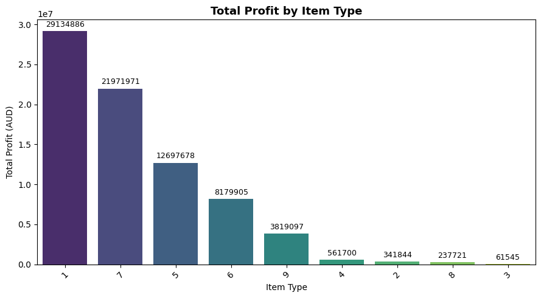
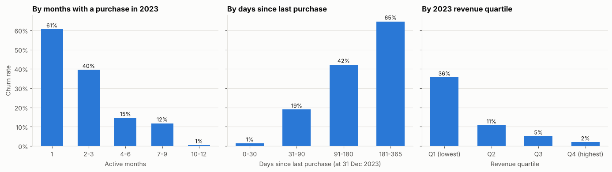
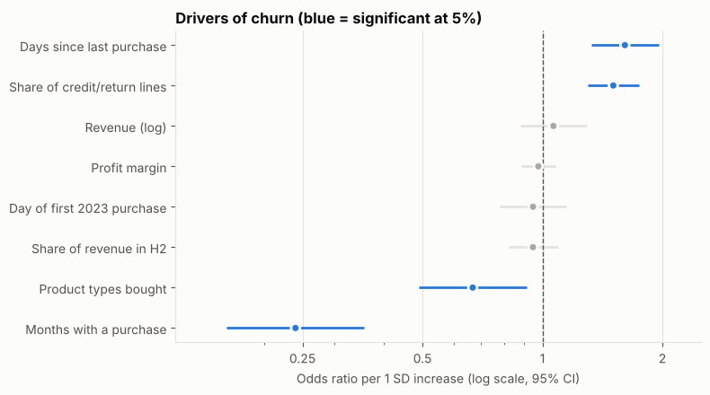

# 💡 LuminaTech Sales & Customer Churn Analysis

End-to-end analysis of ~2M B2B sales transactions (2023–2024) from a lighting products company. Part 1 explains what drives revenue, profit and returns. Part 2 finds which customers stop buying and flags who is at risk next. Built as an academic project at Macquarie University (Master of Business Analytics).

## 🏆 Key results
| | Finding |
|---|---|
| 📦 **Profit** | Three product types (1, 7 and 5) generate most of the profit; several others contribute very little |
| 🔁 **Returns** | Item Type 8 has the highest return rate (~11%) despite low volume |
| 📈 **Margins** | Average profit margin rose from 43.1% to 49.7%, but price adjustments grew significantly in 2024 (p = 0.0012) |
| 👋 **Churn** | 13.4% of customers stopped buying in 2024, but they made up only 1.6% of revenue |
| 🎯 **Churn model** | Logistic regression ranks churn risk with ROC-AUC 0.93; the top 10% highest-risk customers capture half of all churners |
| 📋 **Action list** | 238 at-risk regular buyers worth ~A$6.0M flagged for retention |

## 📊 Part 1 – Sales performance analysis
**Notebook:** [`01_sales_performance_analysis.ipynb`](01_sales_performance_analysis.ipynb)

**Question:** What drives LuminaTech's revenue, profit and returns?



- Cleaned ~2M transactions: removed duplicates, handled missing values and outliers, standardised codes and converted currencies to AUD.
- Built KPIs (revenue, profit, margin, return rate) and analysed them by month, product, district, currency and customer.
- Two-sample t-tests on year-over-year margin, invoicing speed and price adjustments.
- Multiple linear regression explaining 89.3% of the variation in sales value (R² = 0.893).

## 🔄 Part 2 – Customer churn analysis
**Notebook:** [`02_customer_churn_analysis.ipynb`](02_customer_churn_analysis.ipynb)

**Question:** Which customers stop buying, and can we flag them early?
**Churn definition:** bought in 2023, no purchase in 2024. Features use 2023 data only, so there is no look-ahead.



- Built 15+ customer-level features: recency, frequency, active months, revenue, margin, product breadth, return share.
- **Buying regularly protects:** customers active in 10+ months churned at under 1%, versus 61% for one-month buyers.
- **Returns signal risk:** a higher share of credit or return lines raises the odds of churning by about 50% per standard deviation.
- Compared a recency-only baseline, logistic regression and random forest with 5-fold cross-validation; chose logistic regression for similar accuracy and clearer explanations.
- Scored 2024 customers into low, medium and high risk bands for the sales team.



## 📦 Tools
Python (pandas, NumPy) · SciPy · statsmodels · scikit-learn · Matplotlib · Seaborn · Jupyter Notebook

## 📁 Repository structure
```
├── data/
│   └── README.md                          # data source and field guide (raw CSVs not committed)
├── images/                                # charts used in this README
├── 01_sales_performance_analysis.ipynb    # cleaning, KPIs, t-tests, regression
├── 02_customer_churn_analysis.ipynb       # churn segments, model, risk scoring
├── requirements.txt
└── README.md
```

## ▶️ How to run
1. Clone the repo and install dependencies: `pip install -r requirements.txt`
2. Place `2023.csv` and `2024.csv` in the `data/` folder (see [`data/README.md`](data/README.md)).
3. Open the notebooks in Jupyter and choose **Run → Run All Cells**. Each notebook runs on its own.

## ⚠️ Limitations
- Only one churn period (2023→2024) is available, so the churn model is validated with cross-validation rather than on a later year.
- Customers who reduced spending sharply but did not stop entirely are not counted as churned.
- The NZD business has no customer codes and is excluded from the churn analysis.

## 👤 Author
**Paige (Ha Phuong Dinh)** · [LinkedIn](https://www.linkedin.com/in/phuonghadinh/)
